# SukinOS 进程内核系统

## 概述

进程内核是 SukinOS 的核心运行时引擎，负责应用的安装、注册、进程管理、状态持久化、事件通信和资源调度。内核采用**单例模式**导出，在应用启动时初始化，管理整个系统中所有应用的生命周期。

## 架构总览

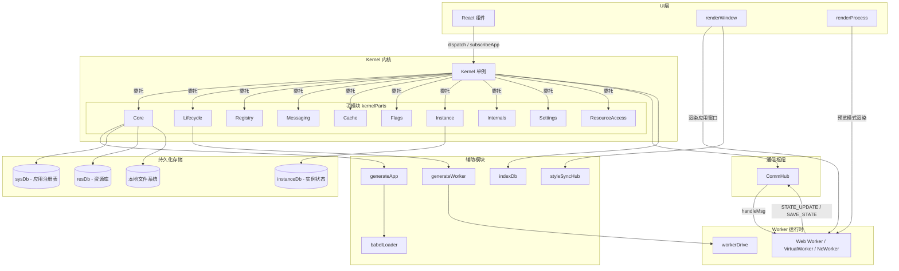

---

## 1. Kernel 类

**文件**: `kernel.js`

Kernel 是系统的核心管理器，采用单例模式导出（`export default new Kernel()`）。它聚合了所有子模块，对外提供统一的公共 API。

### 1.1 构造函数属性

| 分类 | 属性 | 类型 | 说明 |
|------|------|------|------|
| **持久化** | `sysDb` | `IndexDb` | 应用注册表库（`SukinOS_Sys_${userId}`），以 app.name 为主键 |
| | `resDb` | `IndexDb` | 资源库（`SukinOS_Res_${userId}`），以 resourceId 为主键 |
| | `instanceDb` | `IndexDb` | 实例状态库（`SUKIN_STATE_INSTANCE_${userId}`） |
| | `dirHandle` | `FileSystemDirectoryHandle` | 用户授权的本地文件系统目录句柄 |
| **运行时** | `processes` | `Map<pid, {worker, url}>` | 运行中进程的 Worker 实例映射 |
| **注册表** | `systemApps` | `Map<pid, appInfo>` | 系统应用元数据（仅内存） |
| | `userApps` | `Map<pid, appInfo>` | 用户应用元数据（从 sysDb 加载） |
| | `resourceIdToPid` | `Map<resId, pid>` | 资源ID -> 进程ID 双向映射 |
| | `pidToResourceId` | `Map<pid, resId>` | 进程ID -> 资源ID 双向映射 |
| | `resourceCache` | `Object<resId, resource>` | 所有应用资源的内存缓存 |
| **队列** | `installQueue` | `Array` | 安装任务队列 |
| | `isProcessingQueue` | `boolean` | 队列执行锁 |
| **通信** | `commHub` | `CommHub` | 通信枢纽实例 |
| **预设** | `presetResourceIds` | `Set` | 预置资源ID集合 |
| | `currentUser` | `object` | 当前登录用户信息 |
| | `storeDispatch` | `function` | 仓库操作函数 |
| | `useVirtualWorker` | `boolean` | 是否使用虚拟沙箱机制 |

### 1.2 公共 API 分类

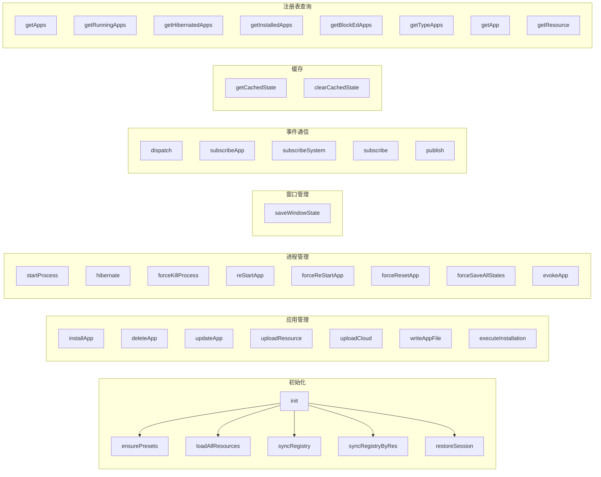

#### 初始化 API

| 方法 | 说明 |
|------|------|
| `init(info)` | 内核初始化，加载资源、构建注册表、恢复会话 |
| `ensurePresets()` | 将系统预置资源写入 resDb |
| `loadAllResources()` | 从 resDb 加载所有资源到内存缓存 |
| `syncSystemAccess()` | 从后端同步当前用户有权访问的系统 APP 列表，白名单模式（仅 `allowed: true` 保留），API 错误时清空所有系统 APP |
| `syncResourcesToFiles()` | 将资源同步写入本地文件系统 |
| `syncRegistry()` | 同步本地文件与注册表（处理僵尸文件/孤儿记录） |
| `syncRegistryByRes()` | 通过资源库构建/补全注册表 |

#### 应用管理 API

| 方法 | 说明 |
|------|------|
| `installApp(params)` | 安装应用（通过队列） |
| `deleteApp(params)` | 删除非系统应用 |
| `updateApp(params)` | 更新应用 |
| `uploadResource(params)` | 上传资源（安装 + 可选云端上传） |
| `uploadCloud(data)` | 上传应用到云端服务器 |
| `writeAppFile(res)` | 将应用写入本地文件 |
| `executeInstallation(params)` | 执行安装/注册（队列处理） |

#### 进程管理 API

| 方法 | 说明 |
|------|------|
| `startProcess({pid, resourceId, interactInfo})` | 启动应用进程（冷启动 / 唤醒休眠 / 已运行时直投 interactInfo） |
| `hibernate(pid)` | 休眠应用（不终止Worker，仅改状态标记） |
| `forceKillProcess(pid)` | 强制终止进程（根据配置决定是否清除状态） |
| `reStartApp({pid})` | 热重启应用 |
| `forceReStartApp({pid})` | 强制重启应用（清除状态后重启） |
| `forceResetApp(pid)` | 强制重置应用（清空状态 + 杀死进程） |
| `forceSaveAllStates()` | 强制保存所有运行中应用的状态 |
| `restoreSession()` | 恢复上一次会话状态 |
| `evokeApp({pid, from, interactInfo})` | 唤起/拉起应用，支持跨应用交互 |

#### 事件通信 API

| 方法 | 说明 |
|------|------|
| `dispatch(pid, action)` | 向指定进程分发 action |
| `subscribeApp(pid, cb)` | 订阅指定应用的状态变化 |
| `subscribeSystem(cb)` | 订阅系统级变更事件 |
| `subscribe(topic, cb)` | 订阅指定主题消息 |
| `publish(topic, payload)` | 发布指定主题消息 |

#### 其他 API

| 方法 | 说明 |
|------|------|
| `getCachedState(pid)` | 获取缓存的应用状态快照 |
| `clearCachedState(pid)` | 清除缓存的应用状态 |
| `saveWindowState(pid, windowRect)` | 保存窗口几何信息 |
| `setDispatch(dispatch)` | 注入仓库操作函数 |
| `updateResourceCustom(data)` | 更新应用的 custom 配置 |
| `isSystemApp(pid)` | 判断是否为系统应用 |
| `getPidByResourceId(resId)` | 通过资源ID获取PID |
| `getResourceIdByPid(pid)` | 通过PID获取资源ID |
| `getApp(pid)` | 获取应用信息 |
| `getResource(resourceId)` | 获取资源信息 |
| `getInstanceDb()` | 获取实例数据库 |

### 1.3 初始化流程

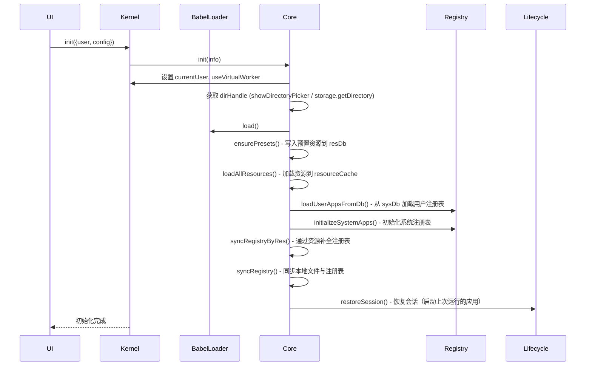

---

## 2. CommHub 通信枢纽

**文件**: `commHub.js`

CommHub 是内核与应用 Worker 之间的通信中枢，集中处理消息分发、状态缓存和系统事件。

### 2.1 核心数据结构

| 属性 | 类型 | 说明 |
|------|------|------|
| `onSaveState` | `function` | Worker 状态保存回调（由 Kernel 注入） |
| `sendToWorker` | `function` | 向 Worker 发送消息的通道（由 Kernel 注入） |
| `eventBus` | `EventTarget` | 系统级事件总线 |
| `subscribers` | `Map<pid, Set<cb>>` | 进程状态订阅者集合 |
| `stateCache` | `Map<pid, state>` | 缓存各进程最新状态 |
| `topicSubscribers` | `Map<topic, Set<cb>>` | 全局主题订阅者 |
| `processSubscriptions` | `Map<pid, Map<topic, unsubFn>>` | 各进程建立的主题订阅（用于进程销毁时清理） |

### 2.2 消息协议

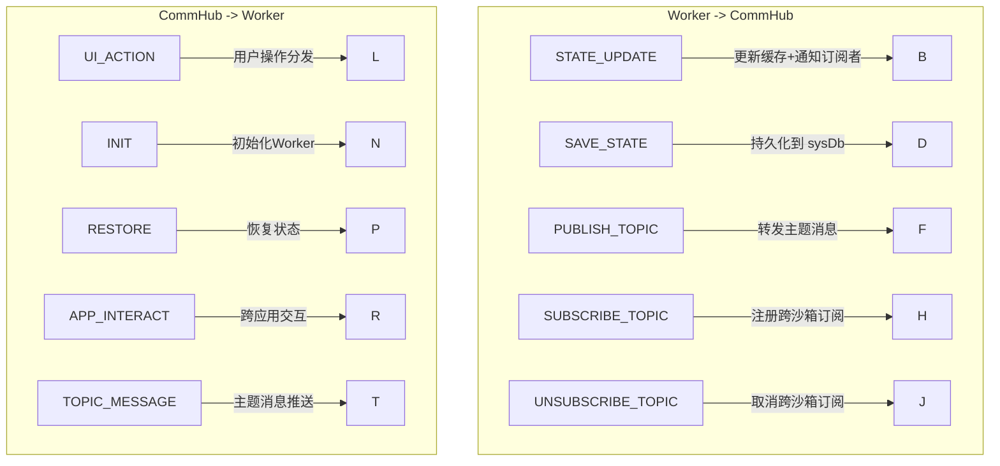

### 2.3 公共方法

| 方法 | 说明 |
|------|------|
| `emitChange(detail)` | 发送系统级变更事件（CustomEvent: 'sys_change'） |
| `notify(pid, type, data)` | 向某个进程的所有订阅者广播状态变化 |
| `getCachedState(pid)` | 获取缓存的状态快照 |
| `clearCachedState(pid)` | 清理缓存的状态快照 |
| `handleMsg(pid, msg)` | 处理来自 Worker 的消息（核心路由） |
| `subscribeApp(pid, cb)` | 订阅单个进程状态变化（返回取消订阅函数） |
| `subscribeSystem(cb)` | 订阅系统级变更事件（返回取消订阅函数） |
| `subscribe(topic, cb)` | 订阅指定主题的消息 |
| `publish(topic, payload)` | 发布指定主题的消息 |
| `clearProcessSubscriptions(pid)` | 清理指定进程的所有主题订阅（防内存泄漏） |

---

## 3. Kernel 子模块架构

**目录**: `kernelParts/`

Kernel 将职责拆分为 10 个子模块，每个子模块持有 Kernel 的弱引用（通过 `#kernel` 私有字段），通过公共方法暴露功能。`main.js` 负责统一 re-export 所有子模块的代理函数。

### 3.1 子模块总览

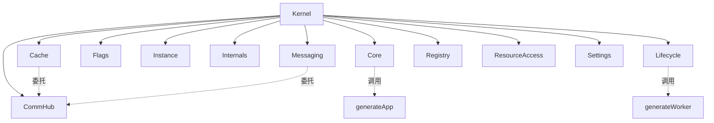

### 3.2 Cache - 缓存管理

**文件**: `kernelParts/cache.js`

代理 CommHub 的状态缓存操作，提供进程状态的读取与清理。

| 方法 | 说明 |
|------|------|
| `getCachedState(pid)` | 通过 CommHub 获取缓存状态 |
| `clearCachedState(pid)` | 通过 CommHub 清除缓存状态 |

### 3.3 Core - 核心业务

**文件**: `kernelParts/core.js`

负责系统初始化、资源加载、应用安装/删除/更新、注册表同步。

| 方法 | 说明 |
|------|------|
| `init(info)` | 完整初始化流程（dirHandle -> Babel -> 预置 -> 资源 -> 注册表 -> 会话恢复） |
| `ensurePresets()` | 写入系统预置资源，初始化 instanceDb |
| `loadAllResources()` | 从 resDb 加载所有资源到 resourceCache |
| `installApp(params)` | 安装应用（走 executeInstallation 队列） |
| `deleteApp(params)` | 删除应用（清理进程/缓存/注册表/资源/沙箱数据） |
| `updateApp(params)` | 更新应用（先终止进程，再覆写安装） |
| `executeInstallation(params)` | 队列化执行安装/注册任务 |
| `syncResourcesToFiles()` | 将资源同步到本地文件 |
| `syncRegistry()` | 同步本地文件系统与注册表 |
| `syncRegistryByRes()` | 通过资源库补全注册表 |
| `writeAppFile(res)` | 写入应用文件到本地 |
| `uploadResource(params)` | 上传资源（安装 + 可选云端上传） |

### 3.4 Flags - 标志位

**文件**: `kernelParts/flags.js`

管理系统应用标识和仓库 dispatch 注入。

| 方法 | 说明 |
|------|------|
| `isSystemApp(pid)` | 判断 PID 是否为系统应用 |
| `setDispatch(dispatch)` | 注入 storeDispatch 函数 |

### 3.5 Instance - 实例管理

**文件**: `kernelParts/instance.js`

提供 instanceDb 的访问入口。

| 方法 | 说明 |
|------|------|
| `getInstanceDb()` | 返回 instanceDb 实例 |

### 3.6 Internals - 内部操作

**文件**: `kernelParts/internals.js`

封装内部操作：队列管理、进程终止、僵尸文件检查、云端上传。

| 方法 | 说明 |
|------|------|
| `inspectZombieFile(fileHandle)` | 检查僵尸文件（物理存在但无注册记录） |
| `uploadCloud(data)` | 上传应用到云端服务器 |
| `kill(pid)` | 终止进程（terminate Worker + revoke URL + 清理订阅） |
| `getProcessApp(pid)` | 获取进程实例 |
| `enqueueInstallTask(task)` | 将任务加入安装队列并触发执行 |
| `processInstallQueue()` | 顺序执行队列中的安装任务 |

### 3.7 Lifecycle - 进程生命周期

**文件**: `kernelParts/lifecycle.js`

管理应用的完整生命周期：启动、休眠、终止、重启、会话恢复。还包含 `VirtualWorker` 和 `NoWorker` 两种替代 Worker 实现。

#### 进程状态机

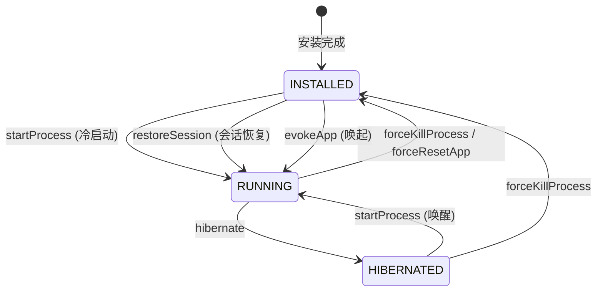

#### 进程启动模式

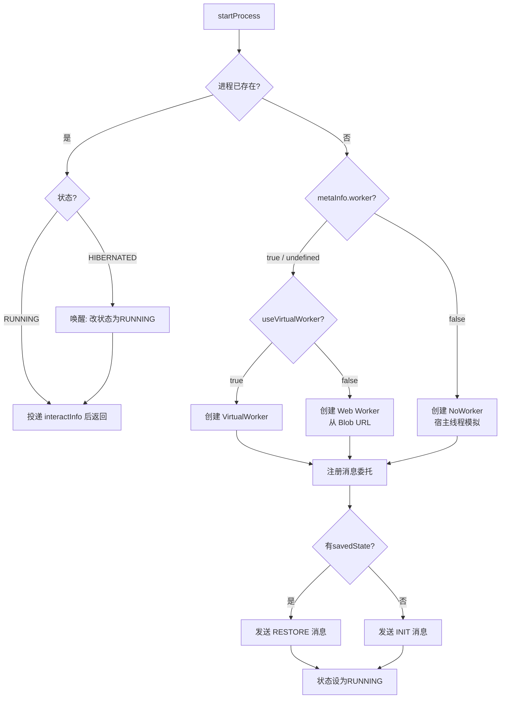

#### VirtualWorker

`VirtualWorker` 是 Web Worker 的轻量化替代方案，使用 `with(sandbox) + Proxy + Shared Iframe` 实现 JS 沙箱隔离。定义在 `lifecycle.js:41-269`。

特性：
- 通过 `new Function('self', 'with(self) { code }')` 执行代码
- 使用隐藏 iframe 的 `contentWindow` 提供隔离环境（`getSharedSandboxIframe()` 创建全局共享沙箱 iframe）
- 拦截并接管 `setTimeout`/`setInterval`/`requestAnimationFrame`，在销毁时自动清理
- 托管全局事件监听器，避免内存泄漏
- STATE_UPDATE 消息通过 `requestAnimationFrame` 帧对齐节流，其他消息通过 `setTimeout(0)` 快速投递
- 支持 `importScripts` 同步脚本加载（通过 XHR 同步请求）
- `addEventListener('message', handler)` 被拦截为 `this.appOnMessage = handler`，确保沙箱内只接收宿主消息

**资源追踪注册表**（lifecycle.js:49-53）：

| 注册表 | 拦截的 API | terminate 清理方式 |
|--------|-----------|-------------------|
| `activeTimeouts` (Set) | `setTimeout` | 遍历 `clearTimeout` |
| `activeIntervals` (Set) | `setInterval` | 遍历 `clearInterval` |
| `activeRAFFrames` (Set) | `requestAnimationFrame` | 遍历 `cancelAnimationFrame` |
| `attachedEventListeners` (Array) | `addEventListener` (非 message) | 遍历 `removeEventListener` |

**消息分流机制**（lifecycle.js:58-81）：

| 消息类型 | 投递方式 | 设计理由 |
|----------|---------|---------|
| `STATE_UPDATE` | `requestAnimationFrame` 帧对齐节流 | 高频状态更新，确保每帧最多投递一次最新的状态 |
| 其他控制流事件 | `setTimeout(0)` 微任务 | 低频事件，需要尽快投递 |

**Proxy 代理层**（lifecycle.js:164-205）：
- `sandboxSelfProxy` 基于 `iframe.contentWindow` 创建 Proxy
- `has: () => true` 确保 `with(sandbox)` 下所有变量查找被拦截
- 所有写操作进入 `localStore`（每个 VirtualWorker 独立内存）
- `boundMethodsCache` (WeakMap) 缓存 `.bind()` 结果防 GC 压力
- 大写开头全局类（Object, Array, Promise）不 bind，直接返回原始引用
- `self` / `globalThis` / `window` 均指向 `sandboxSelfProxy` 自身

> VirtualWorker 消息分流与 Proxy 代理层的完整代码分析详见 [07-app-routing.md](./07-app-routing.md) §3.3

#### NoWorker

`NoWorker` 针对纯前端应用（`worker: false`），在宿主线程模拟 Worker 通信协议。定义在 `lifecycle.js:275-377`。

**sysConfig 构建与注入**（lifecycle.js:286-294）：
NoWorker 在构造时构建完全等价于 Worker 端 `SYS_CONFIG` 的 `sysConfig`，确保广播的 `STATE_UPDATE` payload 格式一致：
```js
this.sysConfig = {
  [ENV_KEY_RESOURCE_ID]: app?.[ENV_KEY_RESOURCE_ID] || '',
  [ENV_KEY_NAME]: app?.[ENV_KEY_NAME] || '',
  [ENV_KEY_IS_BUNDLE]: isBundle,
};
```

**initializeState 校准器**（lifecycle.js:297）：
使用 `initializeState(initialState, isBundle)` 与 Worker 端 INIT handler 完全一致的逻辑初始化状态。Bundle App 的 NoWorker 实例也获得 `{router: {path: 'home'}}` 初始路由。

**初始化时状态广播**（lifecycle.js:301-313）：
构造后，如果存在历史持久化状态（calibratedState 不为 null），立即通过 `setTimeout(0)` 广播给 CommHub 填充 `stateCache`。

**UI_ACTION 处理三种路径**：

| Action 类型 | 处理方式 | 是否改变 state | Echo |
|-------------|---------|---------------|------|
| `STATE_UPDATE` / `UPDATE_STATE` | 直接合并到 `this.state` | ✅ 是 | ❌ |
| `NAVIGATE`（Bundle） | `processStateAction` 注入 `router.path` | ✅ 是 | ❌ |
| 其他 action | `processStateAction` 返回同引用 | ❌ 否 | ✅ ACTION_ECHO |

**ACTION_ECHO 机制**（lifecycle.js:353-360）：
当 `processStateAction` 返回 `nextState === prevState`（无状态变更），NoWorker 产生 `ACTION_ECHO` 消息回调到应用监听器，确保副作用型 action 不被静默跳过。

**SAVE_STATE 兼容分支**（lifecycle.js:364-370）：NoWorker 的 `postMessage` 识别 `SAVE_STATE`，取 `getCachedState(pid)` 后调用 `commHub.saveState(...)` —— 而 CommHub 并没有这个方法（持久化入口是构造时注入的 `onSaveState` 回调），所以这条分支一旦被命中就抛 `TypeError`。当前没有任何调用方会走到它，属已知的死代码；细节见 [07-app-routing.md](./07-app-routing.md) §3.4.4。

> NoWorker sysConfig 注入、processStateAction、ACTION_ECHO 的完整代码分析详见 [07-app-routing.md](./07-app-routing.md) §3.4

| 方法 | 说明 |
|------|------|
| `startProcess({pid, resourceId, interactInfo})` | 启动/唤醒进程（含会话恢复保护） |
| `hibernate(pid)` | 休眠应用（仅改标记，Worker 保持热状态） |
| `forceKillProcess(pid)` | 强制终止进程（根据 saveState 配置决定是否清除状态） |
| `reStartApp({pid})` | 热重启（不清除状态） |
| `forceReStartApp({pid})` | 强制重启（根据 saveState 配置决定清除状态后重启） |
| `forceResetApp(pid)` | 强制重置（**无视 saveState 配置**，清空所有状态 + 杀进程） |
| `saveWindowState(pid, windowRect)` | 保存窗口几何信息 |
| `forceSaveAllStates()` | 强制保存所有运行中应用状态（**不检查 saveState 配置**） |
| `restoreSession()` | 恢复上一次会话（批量启动 RUNNING/HIBERNATED/autoStart 应用） |
| `evokeApp({pid, from, interactInfo})` | 唤起应用（支持跨应用交互，注入 from 信息） |
| `clearAppSavedState(pid)` | 清除应用持久化状态（`savedState` 整体置 null，app + window 一起清） |
| `clearAppSandboxData(app)` | 清理应用沙箱数据（localStorage/sessionStorage/IndexedDB） |

#### startProcess 会话恢复保护

`startProcess` 在冷启动时有会话恢复保护逻辑（lifecycle.js:509-511）：

```js
const targetStatus = originalStatus === 'HIBERNATED' ? 'HIBERNATED' : 'RUNNING';
```

休眠应用在会话恢复时先建立 Worker 实例保持"热"状态，但不自动显示窗口，避免所有休眠应用同时弹出。

#### clearAppSavedState 全量清除

`clearAppSavedState`（lifecycle.js:600-612）直接把 `app.savedState` 置为 `null`，业务状态与窗口几何信息一起清除：

```js
app.savedState = null;  // app + window 一起清
```

窗口几何信息想保留时靠的是 `saveWindowState`（lifecycle.js:531-545）的增量写入：它用 `{...prevSavedState, window}` 的新引用只替换 `window` 分支。

#### forceSaveAllStates 紧急保存

页面卸载前触发 `forceSaveAllStates`（lifecycle.js:552-566）。它对每个进程做两件事，实际持久化只由第二件事完成：

```js
p.worker.postMessage({type: 'SAVE_STATE'})   // ① 即发即忘
this.#kernel.autoSaveState(pid)              // ② 直接从 stateCache 落盘
this.#kernel.autoSaveWindow(pid)
```

- ① 对**真实 Worker 是空操作**：消息路由器没有 `SAVE_STATE` 分支（`workerDrive.js:86-131`，`default: break`）。NoWorker 有兼容分支，但那条分支调的是不存在的 `commHub.saveState`（见 §3.4 的告警），因此同样不产生保存。
- ② 才是生效路径，且**不检查 `saveState` 配置**——无论应用怎么配置都会保存一次，这是"无论配置如何都强制保存"这句话的真实含义。

#### 自动保存定时器（autoSave）

定时器不在 Lifecycle 里，在 Kernel 的 Auto-Save 段（kernel.js:210-270），由 `startAutoSaveState`/`startAutoSaveWindow` 以 `setTimeout` 链式排程（防漂移：每次执行后按当时的最新间隔重排）：

| 条件 | 状态定时器 `startAutoSaveState`（:233-240） | 窗口定时器 `startAutoSaveWindow`（:254-259） |
|------|-------------------------------------------|--------------------------------------------|
| 间隔来源 | `getAutoSaveInterval`（:223-230）：应用级 `metaInfo.custom.autoSaveStateInterval` 优先，> 0 才生效；否则取全局个人化配置；都为 0 则不启动 | 同上，键为 `autoSaveWindowInterval` |
| `metaInfo.saveState` 前置 | **需要为真**（:238）：`saveState: false` 的应用即使配了间隔也不会定时存状态 | **不检查**（:254-259）：窗口几何照存 |

个人化配置一变更，`subscribePersonalization()`（:212-220）会为所有在跑的进程重建两类定时器。

#### restoreSession 会话恢复

`restoreSession()`（lifecycle.js:700-719）批量恢复 `RUNNING`/`HIBERNATED`/`autoStart` 应用，异步启动不阻塞主流程。

#### evokeApp 跨应用唤起

`evokeApp({pid, from, interactInfo})`（lifecycle.js:722-734）注入 `from` 信息，目标 App 已运行则直接发送 `APP_INTERACT`，未运行则冷启动+交互。

#### forceResetApp 无条件重置

`forceResetApp(pid)`（lifecycle.js:618-639）**无视 saveState 配置**强制清空所有状态并杀死进程，用于用户主动发起的彻底重置操作。

> 以上所有 Lifecycle API 的完整调用链与代码分析详见 [07-app-routing.md](./07-app-routing.md) §5-6

### 3.8 Messaging - 消息通信

**文件**: `kernelParts/messaging.js`

管理事件分发、订阅/发布、系统调用路由和跨应用交互。

| 方法 | 说明 |
|------|------|
| `dispatch(pid, action)` | 分发 action（KERNEL_CALL 走系统路由，其他转发 Worker） |
| `subscribeApp(pid, cb)` | 订阅应用状态变化 |
| `subscribeSystem(cb)` | 订阅系统级事件 |
| `subscribe(topic, cb)` | 订阅指定主题 |
| `publish(topic, payload)` | 发布主题消息 |
| `emitChange(info)` | 发送系统级变更事件 |
| `handleMsg(pid, msg)` | 处理 Worker 消息（委托 CommHub） |
| `notify(pid, type, data)` | 通知进程订阅者 |
| `systemSwitch(process, payload)` | 系统应用内核调用路由 |
| `notSystemSwitch(payload)` | 非系统应用内核调用路由 |
| `appIntereact(process, interactInfo)` | 跨应用交互（发送 APP_INTERACT 消息，由 evokeApp 注入 from 信息） |

#### TOPIC_MESSAGE 收方向

CommHub 通过 `sendToWorker` 向订阅进程转发 `TOPIC_MESSAGE`，Worker 消息路由器（`workerDrive.js` 的 `getRunnerMessageRouter`）
为它单开一个 case：把它固定成 action `{type: 'TOPIC_MESSAGE', topic, data}` 交给 `dispatch`，因此目标应用的
`reducer` 按 `action.topic` 分流、从 `action.data` 取负载。未知消息类型仍落 `default: break`。

主题通道是广播式的：发布者自己若订阅了同一 topic 也会收到自己那条消息；订阅记录按 pid 存在
`CommHub.processSubscriptions`，进程销毁时由 `clearProcessSubscriptions(pid)` 一并摘除。

> Pub/Sub 主题体系的完整协议与转发机制详见 [07-app-routing.md](./07-app-routing.md) §7

### 3.9 Registry - 注册表

**文件**: `kernelParts/registry.js`

管理应用注册表：系统应用初始化、用户应用加载、PID/ResourceID 映射、应用查询。

| 方法 | 说明 |
|------|------|
| `initializeSystemApps()` | 从 PRESET_RESOURCES 初始化系统注册表 |
| `loadUserAppsFromDb()` | 从 sysDb 加载用户注册表到内存 |
| `updateSystemAppInfo(pid, info)` | 更新系统应用信息 |
| `updateUserAppInfo(pid, info)` | 更新用户应用信息 |
| `getApp(pid)` | 获取应用（先查系统再查用户） |
| `getPidByResourceId(resId)` | 通过资源ID获取PID |
| `getResourceIdByPid(pid)` | 通过PID获取资源ID |
| `getApps()` | 获取所有应用（含运行状态） |
| `getRunningApps()` | 获取运行中应用 |
| `getHibernatedApps()` | 获取休眠中应用 |
| `getInstalledApps()` | 获取已安装用户应用 |
| `getBlockEdApps()` | 获取被屏蔽的应用 |
| `getTypeApps(appType)` | 按类型获取应用 |

### 3.10 ResourceAccess - 资源访问

**文件**: `kernelParts/resourceAccess.js`

提供资源库的内存缓存访问。

| 方法 | 说明 |
|------|------|
| `getResource(resourceId)` | 从 resourceCache 获取资源 |

### 3.11 Settings - 配置管理

**文件**: `kernelParts/settings.js`

管理应用的 custom 配置（个性化设置），支持持久化到 sysDb。

| 方法 | 说明 |
|------|------|
| `updateResourceCustom(data)` | 更新应用 custom 配置（合并到 metaInfo.custom） |

---

## 4. 辅助模块

### 4.1 generateWorker - Worker 代码生成器

**文件**: `generateWorker.js`

将应用资源（逻辑代码 + 配置 + 元数据）生成完整的 Worker 可执行脚本。

#### 代码结构

生成的 Worker 代码包含以下部分（按实际拼接顺序，标记位物理隔离）：

```
┌──────────────────────────────────────┐
│ getWorkerSandboxPreamble (安全前导)   │  <- 沙箱安全代理注入（含 storage/indexedDB/fetch 代理）
├──────────────────────────────────────┤
│ {  块级作用域                          │
│   ├── RUNNER_SANDBOX_PRIVILEGES       │  <- 沙箱特权边界绑定
│   ├── SYS_CONFIG (系统配置)           │  <- <<<SUKIN_OS_SYS_CONFIG_BLOCK_START_V2>>>
│   ├── APP_METAINFO (应用元数据)        │  <- <<<SUKIN_OS_APP_METAINFO_BLOCK_START_V2>>>
│   ├── Worker 消息分发器 + 消息路由器    │  <- dispatch/broadcast/save + 5 种入站（见 4.2）
│   ├── ORIGIN_COMPONENT (原始内容包)    │  <- <<<SUKIN_OS_ORIGIN_COMPONENT_BLOCK_START_V2>>>
│   ├── PRECOMPILED_COMPONENT (预编译)   │  <- <<<SUKIN_OS_PRECOMPILED_COMPONENT_BLOCK_START_V2>>>
│   ├── Object.freeze(...)              │
│   ├── 逻辑块模块运行时 (__requireLogic) │  <- 无条件注入，见 4.2
│   ├── USER_LOGIC (执行态用户逻辑)      │  <- <<<SUKIN_OS_USER_LOGIC_BLOCK_START_V2>>>
│   └── LOGIC_SOURCE (主逻辑原始源码)    │  <- <<<SUKIN_OS_LOGIC_SOURCE_BLOCK_START_V2>>>
│ }                                     │
└──────────────────────────────────────┘
```

主逻辑的模块 key 取自 `APP_METAINFO.entries.logicMain`，缺失时回落到 `'logic'`（与发布期分层校验、
预览期逻辑模块图使用同一个基准 key）。模块运行时始终挂载：不调用 `require` 时它是惰性的，
按需注入会把"入口规则漏配"变成 worker 静默死机。

#### 标记位系统

使用精确的字符串标记位实现数据块的物理隔离，避免正则表达式解析的性能开销：

| 标记位 Key | 用途 |
|-----------|------|
| `SYS_CONFIG` | 系统配置（resourceId, name, isBundle） |
| `APP_METAINFO` | 应用元数据（author, initialSize, version, entries, precompileIssues 等） |
| `ORIGIN_COMPONENT` | 原始内容包（视图/JSX 源码，含 CSS） |
| `PRECOMPILED_COMPONENT` | 安装期 Babel 预编译产物（CSS 与系统 APP 不入此块） |
| `USER_LOGIC` | 执行态用户逻辑（initialState, reducer, init 函数）：有预编译产物时是 Babel 输出，否则是原文 |
| `LOGIC_SOURCE` | 主逻辑块原始源码的 JSON 字符串，不执行；只在存在预编译产物时写入，供 `parseWorkerCode` 反解回编辑器/本地盘 |

#### 导出函数

| 函数 | 说明 |
|------|------|
| `generateWorker(args)` | 生成完整 Worker 代码字符串 |
| `parseWorkerCode(workerCode)` | 反解析 Worker 代码，提取配置/逻辑/状态 |

### 4.2 workerDrive - Worker 运行时引擎

**文件**: `workerDrive.js` (inline 导出)

提供 Worker 内部的运行时核心逻辑，以源码字符串形式注入到生成的 Worker 脚本中。

#### 核心组件

| 组件 | 说明 |
|------|------|
| `processStateAction(state, action, isBundle)` | 状态路由处理器（处理 Bundle 的 NAVIGATE）。**只有 NoWorker 分支 import**（`lifecycle.js:2`，用于 `:297,342`）；Worker 沙箱内不注入此符号，等价逻辑内联在 `getRunnerWorkerDispatcher`（`:66-72`） |
| `initializeState(baseState, isBundle)` | 初始状态校准器（自动注入 router.home）。同上，仅 NoWorker 使用；Worker 侧的 `INIT` 分支自己补 `router`（`:93-95`） |
| `RUNNER_SANDBOX_PRIVILEGES` | 沙箱特权边界绑定器（块内 `eval`/XHR/importScripts 封禁；`Function` 仅在 worker 环境放行，UI 沙箱仍禁，见下文「沙箱对 `Function` 的放行边界」） |
| `getRunnerWorkerDispatcher(ENV_KEY_IS_BUNDLE)` | 状态分发器工厂源码（创建 dispatch/broadcast/save） |
| `getRunnerMessageRouter(ENV_KEY_IS_BUNDLE)` | 消息协议路由器源码（处理 `INIT`/`RESTORE`/`UI_ACTION`/`APP_INTERACT`/`TOPIC_MESSAGE` 共 5 种入站） |
| `getWorkerLogicModuleRuntime(logicMainKey)` | 逻辑块模块运行时源码（主逻辑 `import` 编译后的 `require('./xxx')` 的解析与求值） |

#### 块内可见的自由标识符（`RUNNER_SANDBOX_PRIVILEGES`）

这段以原样字符串注入块级作用域顶部，决定用户逻辑裸标识符解析到什么（`workerDrive.js:38-49`）：

| 绑定 | 来源 |
|------|------|
| `eval`、`Function`、`setTimeout`、`setInterval`、`fetch`、`indexedDB`、`navigator`、`URL`、`Blob` | `_safeGlobalProxy.<同名>`，即经 `_createSafeProxyHandler(envType)` 过滤后的值（`Function` 的按环境放行见下一节；`eval` 两侧都是 `_forbidden`） |
| `XMLHttpRequest`、`importScripts` | 显式 `undefined`，块内一引用即 `undefined`，不走代理 |

注意两点：这只是**标识符影子**，不封锁属性路径（`globalThis.fetch`、`({}).constructor.constructor` 仍通向真实全局）；未列出的标识符不经这一层，直接落到执行环境自身的全局——真 Worker 里 `clearTimeout` 等解析到 worker global，而 `localStorage`/`requestAnimationFrame` 在 Worker 全局本就不存在；VirtualWorker 里 `globalThis` 解析到 `sandboxSelfProxy`，由它决定给什么。`security.js:432` 的 `blockedProps` 列表（`fetch`/`eval`/`Function`/`XMLHttpRequest`/`importScripts`/`window`/`document`/`self`/`globalThis`/`navigator`）是**代理 `set` 陷阱**侧的覆写封禁，与这张读取绑定表是两套东西。

#### 逻辑块模块运行时（`__requireLogic`）

主逻辑块在 worker 里是以块级作用域裸执行的普通脚本（不是被 `require` 的模块），它 `import` 的依赖经
预编译后都落到内核注入的 `require` 上，由这段注入代码解析与求值：

- 模块产物只来自 `PRECOMPILED_COMPONENT`（安装期编译），路径按调用方所在模块 key 解析
  （`resolveModulePath`，自动补 `.jsx/.js/.css/index` 候选），依赖链可自行延伸。
- 惰性求值 + 结果缓存；CJS 语义与 UI 侧四个求值点一致：先把 `{ exports: {} }` 登记进注册表再执行
  factory，循环依赖的后到者拿到半成品导出而不是递归爆栈，抛错则剔除记录允许下次重试。
- 单一 default 导出时还原为默认值本身，与渲染侧 `exports.default || exports` 同一约定。
- 三类失败各有明确报错：样式文件（worker 无 CSS 模块）、不在内容包（路径或发布形态问题——单页载荷不带模块文件）、
  含 UI 依赖（`looksLikeUiModule` 拦截）；安装期编译失败会读 `APP_METAINFO.precompileIssues` 指认真因。
- 除 `module/exports/require` 外还注入第 4 个形参 `api`（`dispatch`/`getState`/`postMessage`），
  仅 worker 侧存在——这也是页面不得 import 辅逻辑模块的原因之一。

#### 沙箱对 `Function` 的放行边界

`__requireLogic` 要把安装期的编译产物包成可调用模块，只能用 `new Function('module','exports','require','api', code)`。
因此 `getSharedSandboxUtilities` 里的 `_createSafeProxyHandler(envType, ...)` 按环境分流（`security.js`）：

- `envType === 'worker'`：`_safeGlobalProxy.Function` 返回真实构造器。`RUNNER_SANDBOX_PRIVILEGES` 的
  `const Function = _safeGlobalProxy.Function` 因此拿到它，块内 `new Function` 正常。
- `envType === 'ui'`：继续返回 `_forbidden('Function')`。页面模块由渲染侧的 `compileSourceAsync` 用
  Function 构造（`targetFunctionConstructor` 可为 iframe realm 的构造器），不需要在沙箱脚本内自己构造。
- `eval` 两种环境都禁；`window.Function = ...` 这类覆写在两侧的 `set` 陷阱里都仍然抛错。

这是一次有意的取舍，不是遗漏：worker 内一旦有 `Function`，应用逻辑就能用 `Function('return this')()`
取到未被代理的全局，绕开 per-PID 存储代理与 fetch URL 白名单。两点让边际风险小于它听起来的样子：
块内只影子化了**标识符**，`({}).constructor.constructor('return this')()` 本来就不经过任何 proxy；
渲染侧页面模块的构造方式与之同构。VirtualWorker 模式下 `globalThis` 会解析到 `sandboxSelfProxy`
（`lifecycle.js` 的 `has: () => true`），拿到的构造器不经过 `_safeProxyHandler`，与真 worker 行为等价。

#### Worker 内部消息处理流程

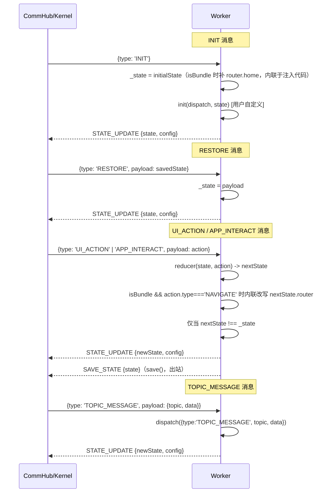

入站类型共 5 种（`INIT` / `RESTORE` / `UI_ACTION` / `APP_INTERACT` / `TOPIC_MESSAGE`，`workerDrive.js:86-131`），未列出的 `type` 落到 `default: break` 被忽略——**`SAVE_STATE` 不在其中**，它是 Worker→Kernel 的出站消息。

### 4.3 generateApp - 应用安装/注册/删除

**文件**: `generateApp.js`

封装所有与应用安装、注册、文件系统同步相关的操作，被 Core 子模块委托调用。

| 函数 | 说明 |
|------|------|
| `extRegisterAppSys(kernel, appSys)` | 注册应用到系统注册表（sysDb + 缓存 + 映射） |
| `extInspectZombieFile(kernel, fileHandle)` | 检查僵尸文件（解析资源ID，判断有效性） |
| `extUploadCloud(kernel, data)` | 上传应用到云端 |
| `extUpdateCloud(kernel, data)` | 更新云端应用 |
| `extInstallResource(kernel, args)` | 核心安装逻辑（写入 resDb + 分配/更新 PID） |
| `extExecuteInstallation(kernel, params)` | 队列化安装/注册执行 |
| `extSyncResourcesToFiles(kernel)` | 将资源同步到本地文件 |
| `extWriteAppFile(kernel, res)` | 写入本地应用文件 |
| `extUploadResource(kernel, args)` | 资源上传（安装 + 可选云端） |
| `extSyncRegistry(kernel)` | 同步本地文件与注册表 |
| `extSyncRegistryByRes(kernel)` | 通过资源库同步注册表 |
| `extUpdateApp(kernel, params)` | 更新应用 |
| `extDeleteApp(kernel, params)` | 删除应用 |

#### 安装流程

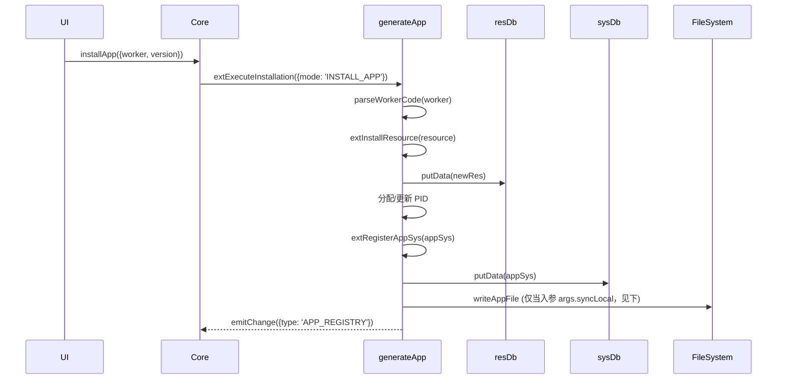

#### 安装期预编译 `precompileResourceContent`

双份存储：`ENV_KEY_CONTENT` 保留原始源码（调试/反编译/提取用），`ENV_KEY_CONTENT_PRECOMPILED`
存 Babel 产物，运行时优先取产物、缺产物才回落运行时编译。主逻辑块同样双份：`ENV_KEY_LOGIC` 存原文、
`ENV_KEY_LOGIC_PRECOMPILED` 存产物，`generateWorker` 按「产物 → 原文 → 兜底 reducer」取值，
因此未预编译的存量应用与系统 APP 行为不变。

- 跳过项：系统 APP（强制走 JSX 编译保证可审计）、`.css` key（交给 `createCssModule`，
  当 JSX 编译必报错）、已有产物的资源（幂等）。
- 失败降级：单模块编译失败不阻断安装，保留原始源码运行时兜底，并把失败清单写进
  `metaInfo.precompileIssues = { reason: 'failed', keys }`，随资源固化到 `APP_METAINFO`，
  供 worker 侧 `require` 报错时指认真因（否则只会被说成路径写错）。
- 该戳以每轮安装结果为准：本轮全部成功即删除，避免上一版的失败记录经云端回灌后长期传播。
  本轮一项都没尝试编译时不改动该戳，免得把别处留下的失败指认无声擦掉。

#### 入口约定的两段式

`entryConfig`（按 uid 存 localStorage，仅开发面板读写）→ 发布时 `buildAppEntries` 折成
`metaInfo.entries = { view, logicMain, logicAux }`（模块 key 形式）固化进资源 → 运行时
`resolveAppEntries(metaInfo)` 读取，缺失回落到 `view:'layout' / logicMain:null / logicAux:[]`。
运行时不读 localStorage，因此换设备、换账号安装的已发布应用行为不随本机配置漂移。

`utils/entryConfig.js` 的 8 个导出（其余为模块私有）：

| 导出 | 位置 | 作用 |
|------|------|------|
| `DEFAULT_ENTRY_CONFIG` | `:12` | `{ logicEntries: ['logic.jsx'], viewEntry: 'layout.jsx', mainEntry: 'main.jsx' }`；`logicEntries` 是**列表**，命中集合的第一个即主逻辑入口 |
| `loadEntryConfig(uid)` | `:27` | 读 `su:dev:entry:<uid>`；uid 缺失/解析失败/字段为空时逐项回落默认值，**不落盘** |
| `saveEntryConfig(uid, config)` | `:45` | 写同一条 key；uid 缺失直接返回 `false`（不报错，UI 需自行提示"请先登录"） |
| `moduleKeyOf(path)` | `:56` | 相对路径 → 内容包模块 key（去 `.jsx/.js` 后缀；`.css` 因不匹配正则而保留后缀） |
| `matchEntryPattern(pattern, path)` | `:64` | 模式匹配：无 `*`/`?` 时走全等；`*` 段内不通配 `/`，`**` 跨段（并吞掉紧随的 `/`），`?` 单字符；其余正则元字符逐个转义 |
| `detectLogicEntryFiles(files, config)` | `:85` | 按**模式声明顺序**收集命中文件（同模式内路径字母序），跳过 `files[k] === null` 的占位项，保证主入口选取稳定 |
| `findEntryFile(files, spec)` | `:97` | 按入口名定位实际文件，先比 `moduleKeyOf` 再比全等 ⇒ 配置里写 `layout` 或 `layout.jsx` 都能命中 |
| `buildAppEntries(files, config)` | `:108` | 汇总：`{ logicFiles, logicMainFile, logicAuxFiles, viewFile, mainFile, entries }`——带扩展名的**文件路径**给开发面板用，`entries` 是去后缀的**模块 key**，发布时写进 `metaInfo` |

模块 key 规则全链统一：`.jsx/.js` 去后缀、`.css` 保留后缀（内容与 entries 同一口径）。
依赖扫描（`collectRelativeImports`）把 `from './x'` 与 `require('./x')` 同等对待，且整行注释
（`//`、`/*`、块注释续行 `*`）不参与匹配——教学注释里写的 `require('./xxx')` 不是真依赖。
发布前的分层校验（`inspectEntryLayering`）即以此口径检查 key-conflict / 逻辑引样式 /
逻辑依赖缺失 / 主逻辑块写 export / 页面反向 import 辅逻辑，其中前四类是 worker 必炸的硬故障，预览也拦；
最后一条降级为提示，发布仍拦。

#### syncLocal：三处读取点，读的不是同一个字段

`metaInfo.syncLocal`（设置面板"同步策略 → 本地同步"）决定"要不要把应用包写成 `.sukin` 本地文件"，
但代码里读这个开关的三处**入参来源与生效条件各不相同**：

| # | 位置 | 读什么 | 生效条件 | 实际做的事 |
|---|------|--------|----------|------------|
| ① | `extInstallResource`（`generateApp.js:324`） | **`args.syncLocal`**（安装入参的顶层字段，**不是** `metaInfo.syncLocal`） | 调用方显式传 `syncLocal: true` | `kernel.writeAppFile({...newRes, content})` 写盘，再 `dirHandle.getFileHandle()` 把句柄挂到 `appSys.handle`；取句柄失败只 `console.warn` |
| ② | `extSyncResourcesToFiles`（`:367-378`） | `res[ENV_KEY_META_INFO].syncLocal` | `kernel.dirHandle` 存在；跳过 preset 资源 | 逐条比对：本地已有同名 `${SUKIN_PRE}${name}${SUKIN_EXT}` 就跳过，否则 `writeAppFile`。**当前没有启动期调用方**——`core.js:68` 那行 `await this.syncResourcesToFiles()` 是注释状态，只有外部手动调 `kernel.syncResourcesToFiles()` 才会跑 |
| ③ | `extSyncRegistryByRes`（`:547-562`） | `appSys[ENV_KEY_META_INFO].syncLocal`（值来自资源 metaInfo） | `kernel.dirHandle` 存在，且该资源尚未注册 | 启动扫描补注册时顺手关联本地句柄；取不到句柄就 `writeAppFile(res)` 再取一次，仍失败只 warn。这是**唯一在开机链上真正生效**的一处（`core.js:62`） |

因此实际口径是：面板里勾"本地同步"→ 只有 ③ 会在下次启动扫描时把包写到本地目录并绑定句柄；
①（安装当场写）需要调用方额外传顶层 `args.syncLocal`，目前开发者中心/上传/更新/本地开发四条
`kernel.uploadResource(...)` 链路都只把它放进 `metaInfo`，所以 ① 的写盘分支对面板发布是走不到的。
② 作为"注册表 → 本地"的批量回灌能力存在但无人调用。改动同步策略时三处都要看，
只改 ① 的判断条件不会改变面板用户的可见行为。

另外 `extSyncRegistry`（`:418+`）反向负责清理"僵尸文件 / 孤儿记录"，它按文件名比对而不看 `syncLocal`，
所以关掉开关不会自动删掉已写出的本地文件。

### 4.4 babelLoader - Babel 转译器

**文件**: `babelLoader.js`

将 JSX 代码转译为标准 JavaScript，支持沙箱环境下的 React pragma 定制。

| 方法/属性 | 说明 |
|-----------|------|
| `loaded` | 是否已加载标记 |
| `CDN_URL` | Babel CDN 备用地址 |
| `load()` | 加载 Babel（优先本地 `@babel/standalone`，fallback CDN） |
| `transform(code)` | 转译 JSX 代码（pragma: `AppSDK.React.createElement`） |

关键转译配置：
- `pragma`: `AppSDK.React.createElement`（适配沙箱中的 SDK）
- `pragmaFrag`: `AppSDK.React.Fragment`
- `runtime`: `classic`（启用自定义 pragma）
- `presets`: `['env', ['react', { pragma, pragmaFrag, runtime }]]`

### 4.5 renderProcess - 进程渲染器

**文件**: `renderProcess.jsx`

用于预览模式的进程渲染组件。维护独立的 Logic Worker 执行环境，动态编译视图源码并转换为 React 组件。

核心特性：
- **Worker 状态机**: 为预览创建独立的 Worker 实例，兼容 `generateWorker` 生成格式
- **幽灵沙箱 (Ghost Sandbox)**: 隐藏 iframe，拦截 `indexedDB`/`localStorage` 等敏感 API
- **ErrorBoundary**: 运行期错误边界容器，捕获渲染错误
- **模块编译**: 通过 `compileSourceAsync` 编译视图源码，延迟 400ms 防抖
- **CSS 作用域**: 使用 `scopeCss` 为样式添加 `#proc-${pid}` 前缀隔离
- **单文件/Bundle 模式**: 自动识别是否为 Bundle 应用，动态路由页面

### 4.6 renderWindow - 窗口渲染器

**文件**: `renderWindow.js`

提供视图源码编译工具和 CSS 作用域隔离功能。

| 函数 | 说明 |
|------|------|
| `compileSourceAsync({sourceCode, pid, targetFunctionConstructor, module, precompiled, moduleRegistry, currentModuleKey}, options)` | 编译源码为可执行 factory 函数（**单一对象入参**，`renderWindow.js:124-127`；`module` 默认 `'component'`、`precompiled` 默认 `false`） |
| `scopeCss(css, pid)` | CSS 作用域隔离（添加 `#proc-${pid}` 前缀） |

`compileSourceAsync` 流程：
1. 通过 SHA-256 哈希检查编译缓存（`compileCache`，:59,138）
2. `precompiled: true` 时跳过 Babel，直接使用安装期产物（:142）；否则加载 Babel 转译 JSX
3. 注入安全沙箱工具（StorageProxy, IndexedDBProxy, SecureFetch）
4. 生成包含完整安全前导的 factory 函数
5. 多模块场景注入模块解析上下文 `__moduleRegistry`/`__currentModuleKey`/`__moduleKeys`，模块内 `require` 经 `__resolveModulePath` 解析后 `factory.call` 求值（:238-249,286-289）
6. `targetFunctionConstructor` 可传 iframe realm 的 Function 构造器，使 factory 的 `globalThis` 落在该文档内

> `renderWindow.js:116-122` 的 JSDoc 仍写作 `@param sourceCode / pid / targetFunctionConstructor` 三个位置参数，与 `:124-127` 的真实对象入参不一致 —— 以代码签名为准，注释待修。

### 4.7 indexDb - 通用数据库封装

**文件**: `indexDb.js`

通用的 IndexedDB 操作类，支持主键、索引和事务。

| 方法 | 说明 |
|------|------|
| `openDB()` | 打开数据库连接（处理版本升级和索引创建） |
| `putData(d)` | 写入数据 |
| `getData(k)` | 获取数据 |
| `getAllData()` | 获取所有数据 |
| `deleteData(k)` | 删除数据 |
| `updateData(k, val)` | 更新数据（读取旧数据 -> 合并 -> 写入） |
| `clearAll()` | 清空所有数据 |
| `isOpen()` | 检查数据库是否已打开 |

配置项：
- `DB_NAME`: 数据库名称
- `STORE_NAME`: ObjectStore 名称
- `KEY_PATH`: 主键路径（默认 `'id'`）
- `VERSION`: 版本号（默认 `1`）
- `INDEXES`: 索引配置数组 `[{name, keyPath?, unique?}]`

### 4.8 styleSyncHub - 样式同步枢纽

**文件**: `styleSyncHub.js`

将宿主文档的 CSS 样式同步到 iframe 沙箱中，确保应用窗口使用系统主题样式。

工作原理：
1. 读取 `document.styleSheets` 中所有已解析的 CSS 规则文本
2. 以 `<style>` 内联方式注入到目标 iframe document
3. 同步主文档 `<html>` 的 class（暗色模式切换）

观察器机制：
- **headObserver**: 监听 `<head>` 新增/删除样式节点
- **contentObserver**: 监听 `<style>` 内容变化（Tailwind JIT / Emotion）
- **themeObserver**: 监听 `<html>` class 变化（暗色模式）

| 方法 | 说明 |
|------|------|
| `registerSandboxDoc(targetDoc)` | 注册 iframe document，立即同步并持续跟踪（返回卸载函数） |

---

## 5. 核心调用链

### 5.1 应用安装完整调用链

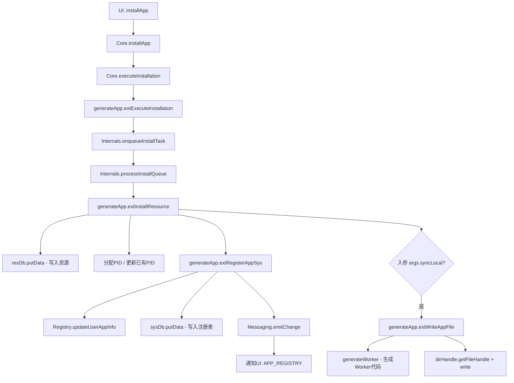

### 5.2 应用启动完整调用链

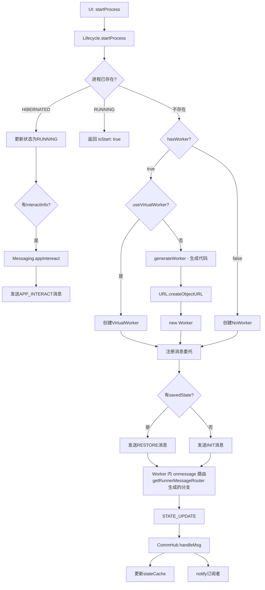

### 5.3 UI Action 分发链

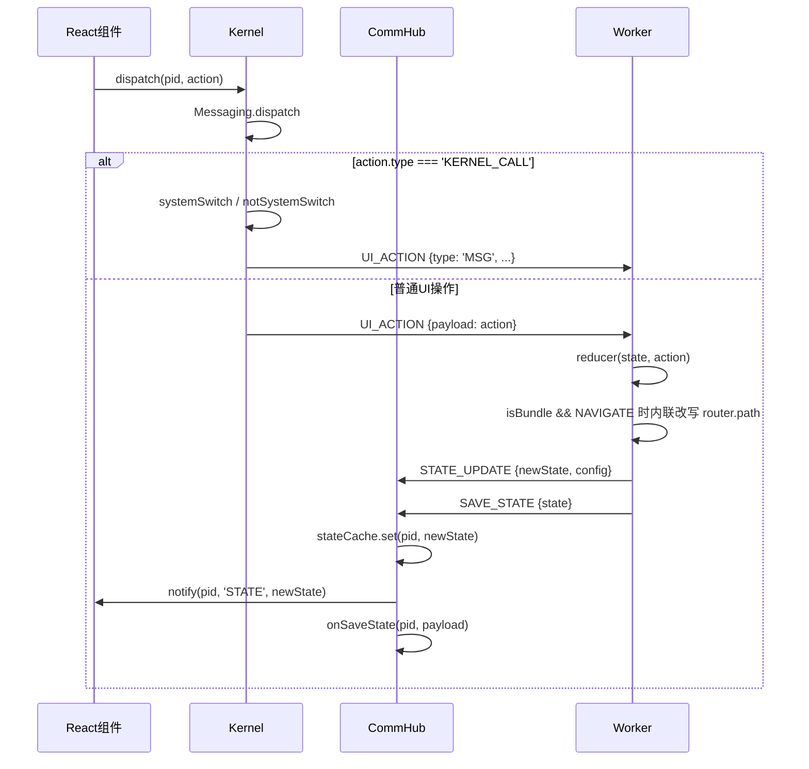

### 5.4 跨应用通信链

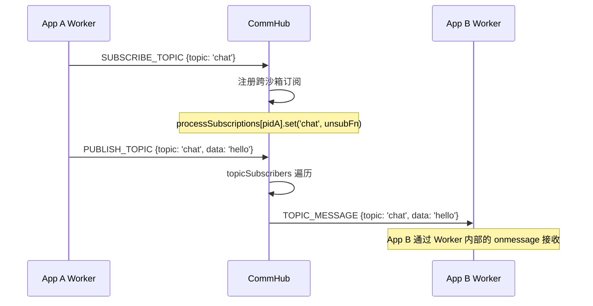

---

## 6. 数据模型

### 6.1 应用注册表记录 (appInfo)

```javascript
{
  pid: 'uuid',                      // 进程唯一标识
  [ENV_KEY_RESOURCE_ID]: 'res-id',   // 关联资源ID
  [ENV_KEY_NAME]: 'app-name',       // 应用名称
  handle: FileSystemFileHandle,      // 本地文件句柄（可能为null）
  savedState: {                     // 持久化状态
    app: { /* 应用内部状态 */ },
    window: { /* 窗口几何信息 */ }
  },
  status: 'INSTALLED' | 'RUNNING' | 'HIBERNATED',  // 应用状态
  isSystemApp: boolean,             // 是否为系统应用,实际并不参与SDK的分发,目前系统级别只会在preset_resources.jsx产生注册并内存判定
  [ENV_KEY_META_INFO]: {            // 元数据
    initialSize: { w: 500, h: 400 },
    version: '0.1',
    createdAt: 'ISO date',
    appType: 'system',              // 自由字符串；'system' 有语义（lifecycle.js:774 据此走系统应用路径），用户应用取 editor/game/tool 或自定义值
    worker: true,                   // 是否使用Worker（false=纯前端）
    saveState: true,                // 关闭时是否保存状态
    syncLocal: true,               // 是否同步到本地文件
    blockEd: false,                 // 是否被屏蔽
    custom: {                       // 用户个性化配置
      autoStart: false,            // 开机自启
      position: { x, y },         // 窗口位置
      // ...
    }
  }
}
```

### 6.2 资源记录 (resource)

```javascript
{
  [ENV_KEY_RESOURCE_ID]: 'res-id',
  [ENV_KEY_NAME]: 'app-name',
  [ENV_KEY_IS_BUNDLE]: true/false,
  [ENV_KEY_CONTENT]: { /* 视图组件内容 */ },
  [ENV_KEY_LOGIC]: 'initialState = {}; function reducer(s) { return s; }',
  [ENV_KEY_META_INFO]: { /* 同上 */ }
}
```

### 6.3 三数据库架构

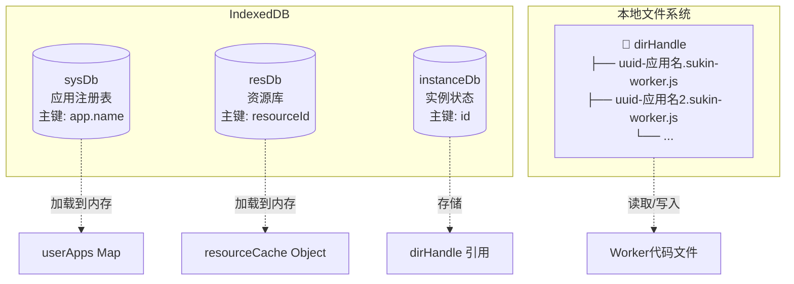

---

## 7. 文件结构

```
process/
├── kernel.js                 # Kernel 单例（公共 API + 子模块聚合）
├── commHub.js                # 通信枢纽（消息路由 + 状态缓存）
├── generateWorker.js          # Worker 代码生成器
├── workerDrive.js             # Worker 运行时引擎（inline 源码）
├── generateApp.js            # 应用安装/注册/删除/同步操作集
├── babelLoader.js            # Babel JSX 转译器
├── renderProcess.jsx         # 进程预览渲染器
├── renderWindow.js           # 窗口渲染器（compileSourceAsync + scopeCss）
├── indexDb.js                # 通用 IndexedDB 封装
├── styleSyncHub.js           # 样式同步枢纽（宿主 -> iframe）
└── kernelParts/
    ├── main.js               # 统一 re-export 所有子模块函数
    ├── cache.js              # Cache - 缓存管理
    ├── core.js               # Core - 核心业务
    ├── flags.js              # Flags - 标志位
    ├── instance.js           # Instance - 实例管理
    ├── internals.js          # Internals - 内部操作
    ├── lifecycle.js          # Lifecycle - 进程生命周期
    ├── messaging.js          # Messaging - 消息通信
    ├── registry.js           # Registry - 注册表
    ├── resourceAccess.js    # ResourceAccess - 资源访问
    └── settings.js           # Settings - 配置管理
```
